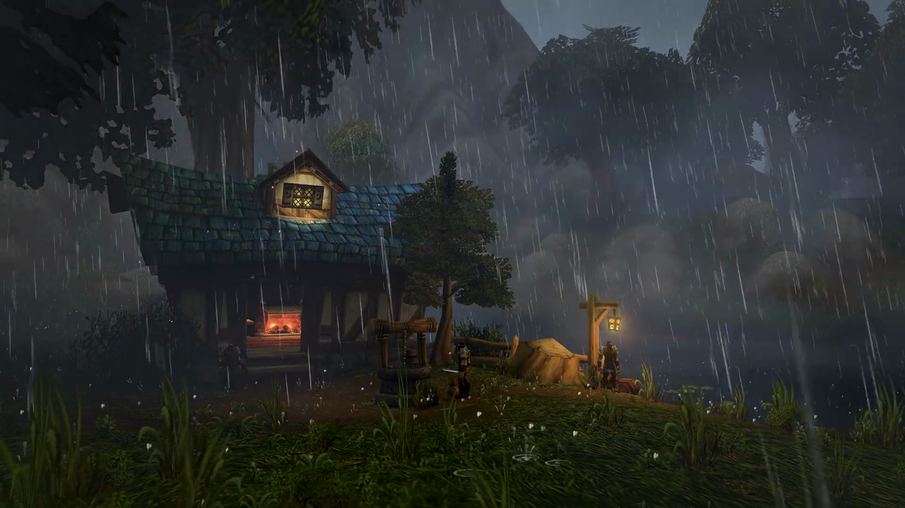

# WoW Rain — Omarchy theme

A calm, rainy World of Warcraft cottage as a **seamless looping video wallpaper**, with subtle storm-blue and silver accents.



## Install

Requires Omarchy 4.5+ (video wallpaper support).

```bash
omarchy theme install https://github.com/Athesias/omarchy-wow-rain-theme
omarchy theme set wow-rain
```

## What's inside

- `backgrounds/01-cottage-rain.mp4` — 100-second 1080p30 loop. The camera's natural sway cycle was matched frame-exactly and the wrap point crossfaded over 2.5 s, so it plays continuously with no visible seam.
- `colors.toml` — dark slate background, rain-silver text, storm-blue accent, and a soft blue → silver gradient on the active window border.

## Credits

Footage from [One Hour of Rain | World of Warcraft: Forever](https://youtu.be/0LeB4u9Zexs) by Blizzard Entertainment (49:00–55:00). World of Warcraft is a trademark of Blizzard Entertainment; this is an unofficial fan theme.
